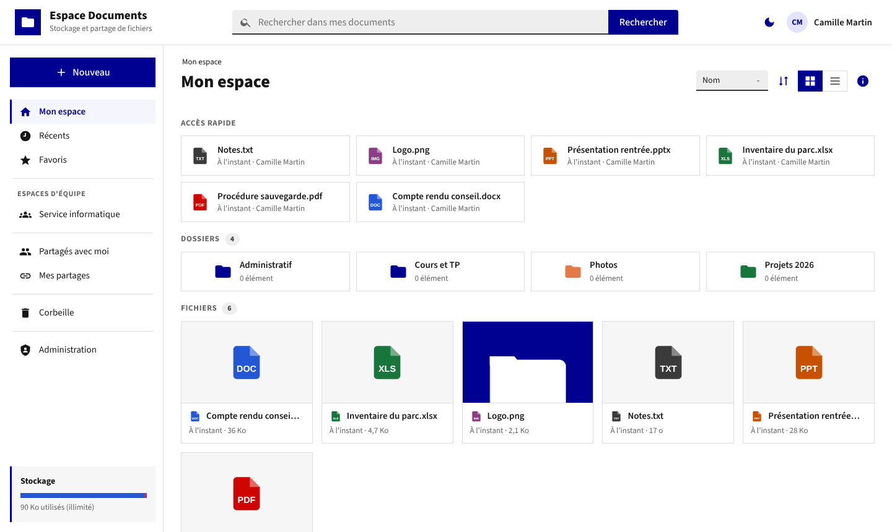
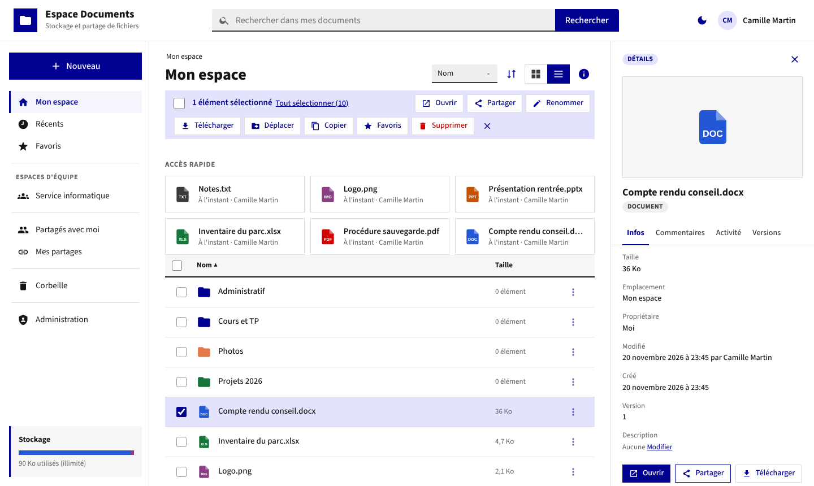
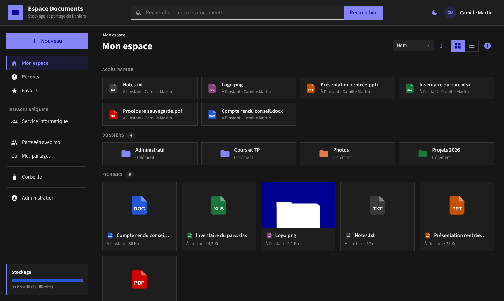
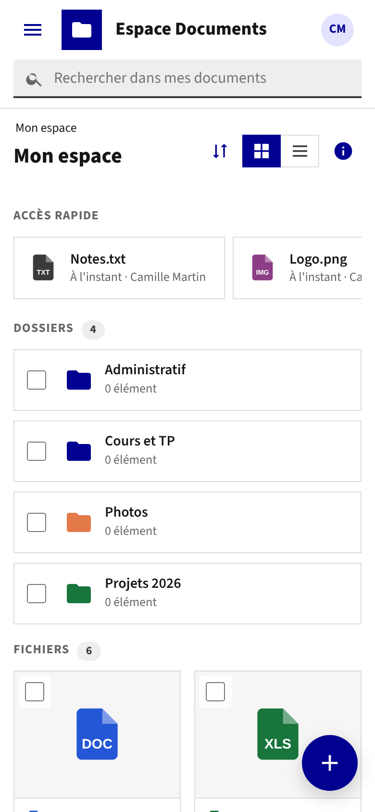

# Drive Ticeconnect

[](https://github.com/Xeros59/Drive-Ticeconnect/actions/workflows/docker.yml)
[](LICENSE)

**Espace Documents** : drive web auto-hébergé, en français, au style institutionnel sobre : stockage, partage et édition de documents en ligne. Il fonctionne sans service cloud tiers, et vos fichiers restent sur votre serveur.



Il existe en **deux versions**, avec la même interface et les mêmes fonctions :

| | [**Version Docker / Node.js**](node/) | [**Version PHP**](php/) |
|---|---|---|
| Pour qui | VPS, serveur dédié, Portainer | N'importe quel hébergement PHP (mutualisé compris) |
| Prérequis | Docker (ou Node.js 20+) | PHP 8.1+ avec `pdo_sqlite` et `mbstring` (`zip` conseillé) |
| Installation | Une image Docker et une stack | Copier les fichiers, ouvrir l'adresse |
| Base de données | SQLite (intégrée) | SQLite (intégrée) |
| Gros fichiers | Envoi direct | Envoi automatique par morceaux (contourne `upload_max_filesize`) |
| Réglages | Variables d'environnement | Interface d'administration (ou `config.php`) |
| Documentation | [node/README.md](node/README.md) | [php/README.md](php/README.md) |

## Fonctionnalités

**Fichiers**
- Dossiers et sous-dossiers, envoi de fichiers et de dossiers entiers (glisser-déposer, coller une capture d'écran)
- Clic simple pour ouvrir. Cases à cocher, Ctrl/Maj+clic ou appui long (mobile) pour sélectionner plusieurs éléments
- Renommer, déplacer (glisser sur un dossier ou sur le fil d'Ariane, ou Ctrl+X puis Ctrl+V), copier, dupliquer, télécharger en zip
- Favoris, récents, couleurs, commentaires, descriptions
- Corbeille avec restauration et purge automatique
- Historique des versions, avec restauration
- Extraction des archives `.zip` sur le serveur
- Aperçu des images, vidéos, sons, PDF et textes, avec un éditeur de texte intégré

**Recherche**
- Dans les noms, les descriptions **et le contenu** des documents : texte, Word, Excel, PowerPoint, OpenDocument, PDF
- Sans tenir compte des accents, avec l'extrait trouvé surligné

**Partage et travail d'équipe**
- Partage avec d'autres comptes, en lecture ou en modification
- **Espaces d'équipe** : dossiers communs avec des responsables, des membres et des lecteurs, et leur propre quota
- **Liens publics** en Lecture, en Modification ou en **Dépôt seul** (on envoie des fichiers sans voir le contenu), avec mot de passe et date d'expiration en option

**Édition en ligne avec OnlyOffice Docs** (facultatif)
- Création et modification de documents, classeurs et présentations, avec plusieurs personnes en même temps
- Lecture seule pour les anciens formats et les PDF, et modification possible pour les invités d'un lien public

**Accès et sécurité**
- Comptes, rôles et quotas, avec une page d'administration
- Double authentification (TOTP) et codes de secours
- **WebDAV**, avec des mots de passe d'application : montez le drive comme un lecteur réseau sous Windows, macOS ou Linux, ou dans OnlyOffice mobile
- Protection contre la force brute, jetons signés, protection CSRF

**Interface**
- Thème clair ou sombre, adaptée au mobile, raccourcis clavier
- Appli installable (PWA), avec la photo directe et la réception des fichiers depuis le menu « Partager » d'Android

| Liste et panneau de détails | Thème sombre | Mobile |
|---|---|---|
|  |  |  |

## Démarrage rapide

**Docker / Portainer**, voir [node/README.md](node/README.md). Une image est publiée automatiquement (amd64 + arm64) :
```
ghcr.io/xeros59/drive-ticeconnect:latest
```
```bash
cd node
cp .env.example .env     # renseignez les variables
docker compose up -d
```

**Hébergement PHP**, voir [php/README.md](php/README.md) :
1. Copier le contenu du dossier `php/` sur l'hébergement (par FTP ou en SSH)
2. Donner les droits d'écriture sur `data/`
3. Ouvrir l'adresse du site : le premier compte créé devient administrateur

## Structure du dépôt

```
espace-documents/
├── node/        Version Docker / Node.js (Express + better-sqlite3)
├── php/         Version PHP (sans Composer ni dépendance)
└── docs/        Captures d'écran
```

Le dossier `public/` (l'interface) est **identique** dans les deux versions. Si vous le modifiez, recopiez-le dans l'autre :
```bash
cp -r node/public/. php/public/
```

## Licence

Distribué sous licence **MIT** : vous pouvez utiliser, modifier et redistribuer le code librement, à condition de conserver la mention de copyright. Voir le fichier [LICENSE](LICENSE).

La bibliothèque incluse dans `public/vendor/qrcode.js` (Kazuhiko Arase) est elle aussi sous licence MIT.
